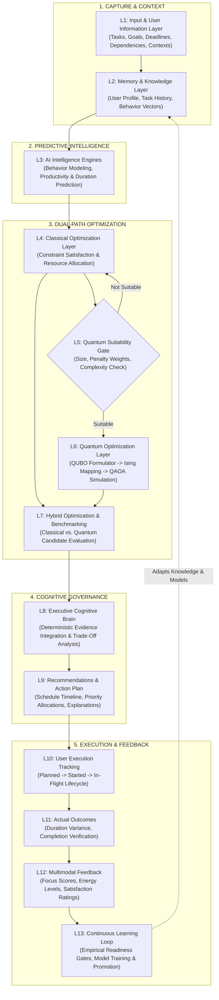

# HelioX AI — Quantum AI Personal Optimization Assistant

[](https://www.python.org/)
[](https://fastapi.tiangolo.com/)
[](https://react.dev/)
[](https://www.typescriptlang.org/)
[](https://vitejs.dev/)
[](https://tailwindcss.com/)
[](https://ai.google.dev/)
[](#quantum-optimization-layer)
[-success.svg)](#testing--verification)

> **Major Academic Project**  
> **Bachelor of Engineering in Computer Science & Engineering (Artificial Intelligence & Machine Learning)**  
> **Institution:** A P S College of Engineering, Bengaluru — 560116  
> **Affiliated to:** Visvesvaraya Technological University (VTU), Belagavi, Karnataka, India  
> **Academic Year:** 2025 – 2026  
> **Project Team:** Bharath P (1AP23CI004), Chandan H K (1AP23CI006), Kiran Reddy C (1AP23CI011), Naveen S (1AP23CI018)  
> **Project Guide:** Prof. Asha N, Associate Professor, Dept. of CSE [AI & ML]

---

## 🌟 Executive Overview

**HelioX AI** is an advanced, multi-layer intelligent personal decision support system designed to transcend the limitations of conventional productivity software. Standard task managers, static to-do lists, and calendar reminders rely on manually assigned priorities and static dates; they possess no contextual awareness, cannot predict personal energy or duration variance, and fail to handle non-trivial task dependencies or multiple conflicting life objectives.

HelioX AI models personal productivity as a **multi-dimensional combinatorial optimization problem** spanning available time, deadlines, priority hierarchies, strict prerequisite DAGs, energy curves, and long-term goal alignment. By fusing **Conversational AI** (powered by Google Gemini), **Behavioral Machine Learning**, **Classical Discrete Optimization**, and a **Quantum Optimization Layer** (QUBO, 1D/2D Ising mapping, and QAOA simulation) governed by an **Executive Cognitive Brain**, HelioX AI delivers adaptive, transparent, and explainable daily execution plans.

---

## 🏗️ The 13-Layer Architecture

HelioX AI is structured across 13 distinct functional layers, ensuring complete modularity, test isolation, and transparent data flow from user intent down to quantum simulation and continuous learning:



### Layer Breakdown

| Layer | Stage | Primary Components | Key Responsibilities |
| :--- | :--- | :--- | :--- |
| **L1: User Information** | Capture | `TaskLifecycleService`, `GoalService` | Ingests tasks, explicit duration estimates (minutes), priorities (P1-P5), deadlines, dependencies, life areas, and goals. |
| **L2: Memory & Knowledge** | Capture | `AIKnowledgeGraph`, `VectorMemoryEmbedding` | Stores user history, behavioral logs, vector embeddings (FAISS/Sentence-Transformers), and goal-task graphs. |
| **L3: AI Intelligence** | Intelligence | `BehaviorIntelligenceEngine`, `ProductivityModel`, `DurationRatioModel` | Random Forest regression modeling predicting completion speed, optimal focus hours, and fatigue curves. |
| **L4: Classical Optimization** | Optimize | `SchedulingEngine`, `MultiObjectiveOptimizationEngine`, `RLScheduler` | Constraint satisfaction scheduling; builds contiguous non-overlapping candidate schedules respecting dependencies. |
| **L5: Quantum Suitability** | Optimize | `AIQuantumIntegrationConfig`, `SuitabilityAnalyzer` | Evaluates problem dimension ($N$ variables, Hamiltonian states); rejects unsuitable problems before quantum compute. |
| **L6: Quantum Optimization** | Optimize | `QUBOProblem`, `IsingProblem`, `QAOACircuit`, `LocalStatevectorSimulator` | Formulates penalty-weighted binary quadratic models, converts to Ising spin Hamiltonians, and simulates QAOA circuits. |
| **L7: Hybrid Comparison** | Optimize | `HybridOptimizer`, `CandidateComparator` | Empirically compares classical vs. quantum candidates on objective score, energy, feasibility, and constraint satisfaction. |
| **L8: Executive Brain** | Decide | `ExecutiveCognitiveBrain`, `ExecutiveGovernanceEngine` | Deterministic cross-engine arbiter; synthesizes evidence, detects conflicts, evaluates risk, and validates governance policies. |
| **L9: Recommendations** | Decide | `AutonomousPlanningEngine`, `ScheduleTimeline` | Outputs actionable daily schedules, priority rankings, alternative plans, and human-readable trade-off rationales. |
| **L10: User Execution** | Learn | `TaskRow`, `TaskLifecycleService` | Manages real-time task progression (`planned` $\to$ `started` $\to$ `completed`) with strict status transition validation. |
| **L11: Actual Outcomes** | Learn | `BehaviorData`, `OutcomeAnalyzer` | Computes execution variance (actual vs. estimated duration ratio, deadline adherence, schedule slippage). |
| **L12: Feedback** | Learn | `FeedbackDialog`, `BehaviorDataModel` | Ingests post-task user ratings (Focus Score 0-100, Energy Level 0-100, Productivity Score 0-100, and qualitative notes). |
| **L13: Continuous Learning** | Learn | `TrainingController`, `SystemComponentRegistry` | Enforces empirical readiness gates ($N \ge 10$ labeled samples); retrains regressors and calibrates user baselines. |

---

## ⚡ Core Features

### 1. Conversational JAM Assistant
- **Primary LLM Integration**: Powered by **Google Gemini** (`gemini-2.5-flash`, `gemini-1.5-flash`, or configurable models) for zero-latency, highly structured natural language plan extraction.
- **Multi-Turn Plan Negotiation**: Conversational schedule proposal generation, automated multi-hour non-overlapping time slotting, overload detection, and plan acceptance/rejection workflows.
- **Resilient Fallback**: Automatic, zero-crash fallback to deterministic rule-based grammar parsing if external LLM APIs are unreachable or unconfigured.
- **Provider Status & Connection Verification**: Live connection testing with zero credential leakage (API keys are never returned to the frontend or exposed in logs).

### 2. Optimization Studio
- **End-to-End Pipeline**: Single-click execution through Classical Optimization $\to$ Quantum Suitability $\to$ Quantum Candidate $\to$ Hybrid Comparison $\to$ Executive Decision $\to$ Recommendation.
- **Dependency Graph Intelligence**: Strict validation of task dependencies preventing circular references ($A \to B \to A$), self-dependencies ($A \to A$), and unauthorized cross-user prerequisite leaks.
- **Unselected Prerequisite Handling**: Intelligently accounts for user backlog and completed prerequisites even when only a subset slice of tasks is selected for optimization.

### 3. Dedicated Quantum Lab
- **Quadratic Unconstrained Binary Optimization (QUBO)**: Mathematical formulation of time-slot assignment and constraint penalties.
- **Ising Model Transformation**: Bijective mapping of binary variables $x_i \in \{0, 1\}$ to spin variables $s_i \in \{-1, +1\}$.
- **QAOA Parameterized Circuits**: Cost Hamiltonian $H_C$ and Mixer Hamiltonian $H_M$ angle optimization ($\gamma, \beta$) executed on a local NumPy statevector quantum simulator.
- **Honest Empirical Benchmarking**: Compares classical and quantum objective functions objectively without falsely claiming quantum superiority on unvalidated classical problems.

### 4. Executive Cognitive Brain
- **Conflict & Overload Detection**: Detects over-allocation and generates three distinct schedule alternatives (Priority First, Balanced Workload, Goal Accelerated).
- **Trade-Off & Risk Profiling**: Explicitly scores cognitive load, deadline risk, and goal acceleration.
- **Governance Audit**: Verifies plan compliance with user-defined rest intervals, maximum continuous focus blocks, and deadline guarantees.

### 5. Enterprise-Grade Security & Isolation
- **Authentication**: `scrypt` password hashing with random salts, HttpOnly cookies, and strict session invalidation.
- **CSRF Protection**: Double-submit CSRF cookie validation combined with database-hashed tokens.
- **Tenant Isolation**: Mandatory `user_id` verification on every database query, vector search, and optimization request.

---

## 💻 Tech Stack

### Backend
- **Core Framework**: [FastAPI](https://fastapi.tiangolo.com/) with [Uvicorn](https://www.uvicorn.org/) (ASGI server)
- **Data & ORM**: [SQLAlchemy 2.0](https://www.sqlalchemy.org/), [SQLite](https://www.sqlite.org/) (Default development), [PostgreSQL](https://www.postgresql.org/) (Production-ready via `psycopg2-binary`)
- **Data Validation**: [Pydantic v2](https://docs.pydantic.dev/)
- **Machine Learning & Math**: [scikit-learn](https://scikit-learn.org/), [NumPy](https://numpy.org/), [Pandas](https://pandas.pydata.org/), [Joblib](https://joblib.readthedocs.io/)
- **Graph & Networks**: [NetworkX](https://networkx.org/) (Dependency DAGs and Cycle Detection)
- **Vector Search & Embeddings**: [FAISS](https://github.com/facebookresearch/faiss), [Sentence-Transformers](https://www.sbert.net/)
- **Reinforcement Learning**: [Gymnasium](https://gymnasium.farama.org/), [Stable-Baselines3](https://stable-baselines3.readthedocs.io/)
- **Testing**: [Pytest](https://docs.pytest.org/), `pytest-asyncio`, `pytest-cov`

### Frontend
- **Framework & Build**: [React 19](https://react.dev/), [TypeScript](https://www.typescriptlang.org/), [Vite 8](https://vitejs.dev/)
- **State & Server Cache**: [TanStack Query v5](https://tanstack.com/query/latest), [Zustand v5](https://github.com/pmndrs/zustand)
- **Styling & UI**: [Tailwind CSS 3.4](https://tailwindcss.com/), [Lucide React](https://lucide.dev/), `clsx`, `tailwind-merge`
- **Animations & Data Viz**: [Framer Motion](https://www.framer.com/motion/), [Recharts](https://recharts.org/)
- **Testing**: [Vitest](https://vitest.dev/), [@testing-library/react](https://testing-library.com/), [Playwright](https://playwright.dev/)

---

## 📂 Repository Structure

```
HelioX_AI/
├── backend/
│   ├── app/
│   │   ├── adaptive/           # Adaptive schedule tuning and dynamic adjustments
│   │   ├── ai_models/          # Scikit-learn regressors (Productivity & Duration models)
│   │   ├── ai_rl/              # Tabular & Gym RL scheduling environments
│   │   ├── cognitive/          # Cognitive load analysis & fatigue curves
│   │   ├── context/            # Context ingestion and temporal state trackers
│   │   ├── database/           # SQLAlchemy DB setup, session factories, and connection pools
│   │   ├── domain/             # Core business models (Task, Goal, Schedule, Dependency)
│   │   ├── engines/            # 14 specialized intelligence & decision engines
│   │   ├── interface/          # LLM Provider abstraction (Gemini, OpenAI, Fallback)
│   │   ├── knowledge/          # Dependency DAGs, Goal Graphs, and Knowledge Bases
│   │   ├── memory/             # FAISS vector store & episodic memory index
│   │   ├── ml/                 # Model registry, readiness gates, & public dataset managers
│   │   ├── models/             # SQLAlchemy ORM database schemas (User, Task, Goal, etc.)
│   │   ├── monitoring/         # AI metrics, health monitors, and latency trackers
│   │   ├── orchestrator/       # AI Orchestrator & Executive Cognitive Brain
│   │   ├── pipeline/           # Decision pipeline stages and validation gates
│   │   ├── quantum/            # QUBO, Ising, QAOA, local statevector simulator & benchmarks
│   │   └── services/           # High-level services (Auth, Chat, Tasks, Goals, Planning)
│   ├── tests/                  # 1,200+ Pytest backend test suites
│   ├── main.py                 # FastAPI application entrypoint and router definitions
│   └── requirements.txt        # Backend Python dependencies
├── frontend/
│   ├── src/
│   │   ├── api/                # Axios API client, OpenAPI types, and TanStack Query hooks
│   │   ├── components/         # Reusable UI primitives, brand elements, and layout shells
│   │   ├── features/           # Feature modules (Tasks, Goals, Optimization, Assistant, etc.)
│   │   ├── lib/                # Architecture definitions, status formatters, and utilities
│   │   ├── pages/              # 12 page views (Overview, Tasks, Studio, Lab, Brain, etc.)
│   │   ├── stores/             # Zustand stores (UI state, user session, chat messages)
│   │   └── __tests__/          # Vitest component, format, and lifecycle unit tests
│   ├── package.json            # Frontend dependencies and npm scripts
│   └── vite.config.ts          # Vite build and test configuration
├── data/
│   └── external_datasets/      # Public benchmark datasets (e.g., UCI Garment Productivity)
├── docs/                       # Architecture specifications, audit reports, and design notes
├── .env.example                # Canonical environment variable template
├── pyproject.toml              # Python project packaging and tool configuration
└── README.md                   # Project documentation
```

---

## 🚀 Getting Started

### Prerequisites
- **Python:** Version 3.11 or higher (Python 3.11 or 3.14 tested)
- **Node.js:** Version 18.0 or higher
- **Package Manager:** `npm` (comes with Node.js) or `pnpm`
- **Git**

---

### Step 1: Clone the Repository
```bash
git clone https://github.com/Bharathp04/HelioX_AI.git
cd HelioX_AI
```

---

### Step 2: Backend Setup

1. **Create and Activate a Virtual Environment**:
   ```bash
   # Windows (PowerShell)
   python -m venv .venv
   .\.venv\Scripts\Activate.ps1

   # Linux / macOS
   python3 -m venv .venv
   source .venv/bin/activate
   ```

2. **Install Python Dependencies**:
   ```bash
   pip install -r requirements.txt
   ```

3. **Configure Environment Variables**:
   Copy the `.env.example` file to `.env`:
   ```bash
   cp .env.example .env
   ```

   Open `.env` and configure your settings:
   ```env
   # Database Configuration (SQLite default)
   DATABASE_URL=sqlite:///./behavior_engine.db

   # Server Configuration
   HOST=0.0.0.0
   PORT=8000
   DEBUG=False

   # Primary LLM Provider: gemini (default), openai, anthropic, groq, ollama
   HELIOX_LLM_PROVIDER=gemini

   # Google Gemini Configuration
   GEMINI_API_KEY=your_google_gemini_api_key_here
   GEMINI_MODEL=gemini-2.5-flash
   ```

   > [!NOTE]
   > If `GEMINI_API_KEY` is left blank, HelioX AI automatically activates its deterministic heuristic fallback parser. All planning, task extraction, and optimization functions remain 100% operational offline without third-party credentials.

4. **Start the Backend Server**:
   ```bash
   python -m uvicorn backend.main:app --reload --port 8000
   ```
   The backend API will be live at `http://127.0.0.1:8000`.  
   Interactive API documentation (Swagger UI) is available at `http://127.0.0.1:8000/docs`.

---

### Step 3: Frontend Setup

1. **Install Node Dependencies**:
   ```bash
   cd frontend
   npm install
   ```

2. **Run the Development Server**:
   ```bash
   npm run dev
   ```
   The frontend application will start at `http://localhost:5173`.

---

## 🧪 Testing & Verification

HelioX AI maintains rigorous test coverage across both frontend and backend layers to ensure mathematical correctness, quantum constraint integrity, and security policies.

### Running Backend Tests (Pytest)
```bash
# Run targeted dependency and optimization suites
python -m pytest backend/tests/test_optimization_dependencies.py backend/tests/test_dependency_intelligence.py backend/tests/test_task_lifecycle_service.py -v

# Run natural language and AI provider tests
python -m pytest backend/tests/test_gemini_integration.py backend/tests/test_f4_jam_api.py -v

# Run full backend test suite
python -m pytest
```

### Running Frontend Tests (Vitest)
```bash
# Run all Vitest suites
npm --prefix frontend test -- --run

# Run type check and production build
npm --prefix frontend run build
```

---

## 🔬 Quantum Optimization Layer Details

HelioX AI’s quantum pipeline provides an authentic mathematical foundation for combinatorial scheduling:

1. **Quadratic Unconstrained Binary Optimization (QUBO)**:
   For binary decision variables $x_{i,t} \in \{0, 1\}$ denoting whether task $i$ is scheduled at time slot $t$:
   $$\min \quad H(x) = \sum_{i,t} C_{i,t} x_{i,t} + \lambda_1 \sum_i \left( \sum_t x_{i,t} - 1 \right)^2 + \lambda_2 \sum_{\text{conflicts}} x_{i,t} x_{j,t} + \lambda_3 \sum_{\text{precedence}} x_{i,t} x_{j,t'}$$
   where $\lambda_1, \lambda_2, \lambda_3$ are penalty multipliers enforcing assignment, collision-avoidance, and dependency ordering.

2. **Ising Spin Formulation**:
   Using the transformation $x_i = \frac{1 - s_i}{2}$ with spin variables $s_i \in \{-1, +1\}$, the problem maps to the Ising Hamiltonian:
   $$H_{\text{Ising}} = \sum_i h_i s_i + \sum_{i < j} J_{ij} s_i s_j$$

3. **QAOA Statevector Simulation**:
   The circuit alternates between the problem Hamiltonian $H_C$ and the transverse-field mixer $H_M = \sum_i X_i$ for $p$ layers:
   $$|\gamma, \beta\rangle = \prod_{k=1}^p e^{-i \beta_k H_M} e^{-i \gamma_k H_C} |+\rangle^{\otimes n}$$
   Optimal variational angles $(\gamma^*, \beta^*)$ are discovered via classical optimization, yielding candidate bitstrings evaluated by the Hybrid Comparison Layer.

---

## 🛡️ Responsible AI & Quantum Safety Gates

1. **Empirical Gate for ML Promotion**: The system explicitly marks personalized models as `NOT_READY_INSUFFICIENT_DATA` until at least 10 authentic completed user tasks with subjective ratings are recorded. Synthetic proxy data is never passed off as personalized intelligence.
2. **Honest Quantum Claims**: HelioX AI clearly labels its quantum execution as a **local CPU statevector simulation ($N \le 8$ qubits)** for research and feasibility assessment; it does not claim to run on physical cryogenic QPU hardware.
3. **Deterministic Fallbacks**: Every AI and quantum component is paired with a mathematically sound classical fallback. The user is never left with an unhandled exception or blocked pipeline.

---

## 📚 References & Academic Citations

1. S. Russell and P. Norvig, *Artificial Intelligence: A Modern Approach*, 4th ed., Pearson, 2021.
2. E. Farhi, J. Goldstone, and S. Gutmann, "A Quantum Approximate Optimization Algorithm," *arXiv:1411.4028*, 2014.
3. A. Lucas, "Ising formulations of many NP problems," *Frontiers in Physics*, vol. 2, p. 5, 2014.
4. K. Kurowski, T. Pecyna, M. Slysz, R. Różycki, G. Waligóra, and J. Węglarz, "Application of Quantum Approximate Optimization Algorithm to Job Shop Scheduling Problem," *European Journal of Operational Research*, vol. 310, no. 2, pp. 518–528, 2023.
5. T. Werner and F. Ullinger, "Quantum algorithms for scheduling problems: a survey," *EPJ Quantum Technology*, vol. 13, article 31, 2026.
6. L. Breiman, "Random Forests," *Machine Learning*, vol. 45, no. 1, pp. 5–32, 2001.
7. R. S. Sutton and A. G. Barto, *Reinforcement Learning: An Introduction*, 2nd ed., MIT Press, 2018.

---

## 👥 Contributors & Acknowledgements

This project was developed as a Final Year Major Project at the **Department of Computer Science & Engineering (Artificial Intelligence & Machine Learning)**, **A P S College of Engineering**, Bengaluru, affiliated with **Visvesvaraya Technological University (VTU)**.

### Student Team
- **Bharath P** (USN: `1AP23CI004`)
- **Chandan H K** (USN: `1AP23CI006`)
- **Kiran Reddy C** (USN: `1AP23CI011`)
- **Naveen S** (USN: `1AP23CI018`)

### Project Guide
- **Prof. Asha N**, Associate Professor, Department of CSE [AI & ML], APS College of Engineering

### Institutional Support
- **Dr. D. G. Anand**, Professor & Head of Department, Dept. of CSE [AI & ML]
- Management and Faculty of **A P S College of Engineering**, Bengaluru

---

## 📄 License

This project is licensed under the [MIT License](LICENSE) — see the LICENSE file for details.
