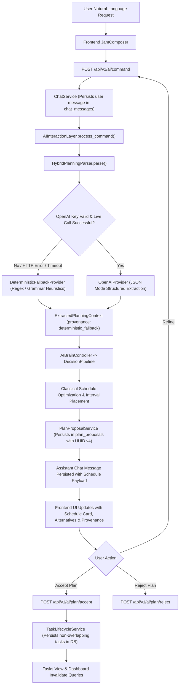

# HELIOX AI — MASTER PROJECT AUDIT REPORT
**Comprehensive Architectural, Database, Security, ML, and Quality Audit**

- **Project:** HELIOX AI (Quantum Life AI) — Intelligent Personal Optimization Assistant
- **Root Directory:** `D:\quantum_life_ai`
- **Audit Execution Date:** October 30, 2026
- **Audit Mode:** Strictly Read-Only (Static Inspection, AST Analysis, Metadata/Aggregate SQLite Inspection, Provenance Verification)
- **Safety Status:** No application code modified, no database altered, no external network calls made, zero git history changes.

---

## 1. Executive Summary

HELIOX AI is an intelligent personal life optimization and adaptive scheduling assistant designed to bridge natural-language user intentions, mathematical optimization, and machine learning behavioral feedback.

### Key Strengths Genuinely Built
1. **Fully Functional End-to-End Vertical Slice:**
   The user can register, log in, create tasks, converse with the JAM (Just Autonomous Management) assistant, extract compound planning requirements, generate multi-criteria schedules with continuous non-overlapping intervals, refine plans conversationally, accept proposals, and persist scheduled intervals into SQLite.
2. **Robust Multi-Layered Authentication & Security:**
   Employs `scrypt` password hashing, HttpOnly session cookies, double-submit and database-hashed CSRF protection, constant-time verification, and strict user isolation filters across path variables, query parameters, JSON request bodies, and task entity ownership.
3. **Rigorous ML Readiness Governance:**
   Unlike systems that expose fake or overfit ML models, HELIOX AI enforces strict readiness gates (`backend/app/ml/readiness.py`). It distinguishes heuristic proxies from genuine human ground truth, holding personalized ML models in `NOT_READY_INSUFFICIENT_DATA` until verified user feedback thresholds ($\ge 10$ labeled samples, $\ge 25$ RL episodes) are met.
4. **Honest Quantum Simulation Disclosure:**
   QUBO/Ising formulations and QAOA statevector simulations are completely implemented in classical Python/NumPy (`LocalStatevectorSimulator`). The frontend and backend transparently state: *"LOCAL CLASSICAL SIMULATION — NO PHYSICAL QUANTUM HARDWARE EXECUTION. Zero quantum advantage claimed."*
5. **Modern, Responsive Frontend:**
   Built with React 18, Vite, TypeScript, Tailwind CSS, and TanStack React Query. Features an interactive Neural Core visualization, dedicated task lifecycle management with post-task feedback modals, and comprehensive diagnostic views.

### Primary Risks & Incomplete Areas
1. **Critical Secret Tracking in Git:**
   `backend/.env` is actively tracked in Git (committed in `6ff8f35 Baseline...`). While root `.env` is ignored, `backend/.env` containing configuration and credentials is in git history.
2. **Database Redundancy & Schema Drift Risk:**
   Four distinct `.db` files exist across the workspace:
   - Root `behavior_engine.db` (258 KB, 7 tables, active authoritative database)
   - `backend/behavior_engine.db` (53 KB, 4 tables, legacy drift)
   - `backend/behavior_engine_demo.db` (53 KB, 2 tables, demo fixture)
   - `data/quantum_life.db` (0 bytes, empty artifact)
   Furthermore, `.env` files contain duplicate `DATABASE_URL` declarations (PostgreSQL followed by SQLite).
3. **LLM Provider Quota/Live Call Discrepancy:**
   The assistant UI displays *"OpenAI Configured (gpt-4o-mini)"* because the key variable is populated in `.env`, but live requests fallback to `DeterministicFallbackProvider` (reporting *"Deterministic Rule-Based Parser (Fallback Active)"* in proposal provenance). Unit tests mock API responses; live OpenAI credentials have not executed verified successful generation in production data.
4. **Uninitialized RL Policy & Model Registry In-Memory Drift:**
   The RL scheduler operates on an uninitialized zero policy (`Q-table` unseeded from real user episodes). The model registry uses in-memory fallbacks on cold restart unless dynamically bootstrapped.

---

## 2. Project Inventory & Directory Architecture

```
D:\quantum_life_ai\
├── backend\
│   ├── app\
│   │   ├── adaptive\          # Adaptive scheduling & replanning logic
│   │   ├── ai_models\         # ProductivityModel (RandomForestRegressor)
│   │   ├── ai_rl\             # RLScheduler & Tabular Q-learning environment
│   │   ├── database\          # db.py, engine builder, connection pool, session factory
│   │   ├── domain\            # ClassicalOptimizer, PredictionMatrix, contracts
│   │   ├── engines\           # QuantumLifeBrain, multi-objective, dependency engines
│   │   ├── interface\         # AIInteractionLayer, llm_provider, nl_extractor
│   │   ├── learning\          # AutonomousLearningLoop
│   │   ├── memory\            # VectorMemorySystem (local transformer / hash fallback)
│   │   ├── ml\                # ModelRegistry, Readiness, SystemInventory, TrainingController
│   │   │   └── datasets\      # QualityAuditor, LeakageDetector, PublicDatasetManager
│   │   ├── models\            # SQLAlchemy models (User, AuthSession, Task, BehaviorData, Chat, Proposal)
│   │   ├── orchestrator\      # AIOrchestrator, AIBrainController, ExecutiveCognitiveBrain
│   │   ├── pipeline\          # DecisionPipeline (central planning execution graph)
│   │   ├── quantum\           # QUBO/Ising domain, QAOA optimizer, local simulator, suitability
│   │   └── services\          # AuthService, BehaviorEngine, TaskLifecycleService, ChatService, PlanProposalService
│   ├── tests\                 # 70 pytest test suites
│   └── main.py                # FastAPI entry point (59 endpoints, CORS, lifespan)
├── frontend\
│   ├── src\
│   │   ├── api\               # Axios client, typed endpoint contracts, TanStack Query hooks
│   │   ├── components\        # Assistant, Layout, NeuralCore, Visualizations, UI primitives
│   │   ├── pages\             # 10 Application pages (Dashboard, Assistant, Tasks, Planning, etc.)
│   │   ├── stores\            # Zustand stores (userStore, jamStore, toastStore)
│   │   └── utils\             # Formatters, presentation helpers
│   ├── package.json           # Vite + React 18 + TailwindCSS dependencies
│   └── vite.config.ts         # Dev proxy to http://127.0.0.1:8000
├── data\
│   ├── external_datasets\     # UCI Garment Productivity benchmark (train, val, test CSVs)
│   └── model_artifacts\       # Benchmark joblib artifacts
└── docs\audits\               # Historical audit reports & validation records
```

---

## 3. Frontend Audit

### Technology & Architecture
- **Framework:** React 18.3.1 with TypeScript 5.8
- **Bundler & Dev Server:** Vite 5.4.19
- **State Management:**
  - Server state: TanStack React Query 5.66.0 (staleTime 15s for tasks/readiness, refetchOnWindowFocus disabled, explicit invalidations).
  - Client state: Zustand (stores for `userStore` session identity, `jamStore` chat messages/active thread, and `toastStore` feedback).
- **Styling:** Tailwind CSS with custom design tokens (dark-mode first, quantum theme accents).

### Page-by-Page Audit

| Page / Route | Core Components | API Connections | Real Capabilities | Incomplete / Mock / Fallback Logic |
| :--- | :--- | :--- | :--- | :--- |
| **Dashboard** (`/`) | `NeuralCore`, `MetricCard`, `TechnicalDetails` | `useSystemHealth`, `useSystemStatus`, `useQuantumStatus`, `useMLModelStatus`, `useTasks`, `useComponentInventory` | Real-time system health, database connection status, active/completed task counters, interactive node topology. | Recent activity relies on client-side sorting of loaded task array. |
| **JAM Assistant** (`/assistant`) | `JamComposer`, `JamMessage`, `JamEmptyState`, conversation sidebar | `useAICommand`, `useProviderStatus`, `useJamConversations`, `useCreateConversation`, `useDeleteConversation` | Natural-language multi-task command processing, conversational refinement, plan proposal review, instant accept/reject actions. | When external LLM is rate-limited or unverified, transparently executes deterministic grammar fallback. |
| **Tasks** (`/tasks`) | `TaskRow`, `TaskCreateDialog`, `TaskFeedbackModal`, `Tabs` | `useTasks`, `useStartTask`, `useCompleteTask`, `useSubmitTaskFeedback`, `useCreateTask` | Filter by All/Pending/Completed, explicit Start and Complete lifecycle buttons, duration difference calculation, post-task 1-5 star rating submission. | Bulk task operations and drag-and-drop reordering not implemented. |
| **Planning** (`/planning`) | `OptimizationPipelineVisual`, `TaskCandidateList`, `ProposalCard` | `useCreateExecutivePlan`, `useLatestExecutiveResult`, `useTasks`, `useAcceptPlan`, `useRejectPlan` | Strict eligibility validation against task contract, multi-hour continuous interval scheduling, overload detection with 3 realistic alternatives. | Plan generation uses in-memory executive request cache; re-evaluates on reload. |
| **Optimization** (`/optimization`) | `OptimizationPipelineVisual`, `HumanStatusBadge`, `TechnicalDetails` | `useTasks`, `useCreateExecutivePlan`, `useBenchmarkQuantum` | Direct execution of executive planning pipeline, mathematical parameter inspection, Pareto weighting breakdown. | Quantum execution is bounded to $\le 8$ variables on local classical simulator. |
| **Intelligence** (`/intelligence`) | `PatternMetric`, `RecommendationList` | `useBehaviorPatterns`, `useDataCollectionStatus`, `useAIRecommendations`, `useTasks` | Visualizes user productivity patterns, energy curves, and heuristics; triggers personalized recommendation generation. | Guarded heuristic fallback active until sufficient verified user tasks accumulate. |
| **Data & Learning** (`/data-learning`) | Readiness badges, Feedback workflow guide, Dataset tables | `useDataCollectionStatus`, `useMLReadiness`, `useMLTrainingStatus`, `useTriggerTraining`, `useBootstrapPublicDataset` | Displays data collection pipeline integrity, temporal split status, UCI benchmark bootstrap trigger, automatic training job progress polling. | Personal model retraining remains gated if human feedback ratings $< 10$. |
| **Quantum Workspace** (`/quantum`) | `QuantumConceptVisual`, Benchmark tables | `useQuantumStatus`, `useBenchmarkQuantum`, `useLatestExecutiveResult` | Mathematical QUBO/Ising inspection, exact classical minimum vs QAOA simulated comparison, full benchmark suite display. | Explicitly discloses local CPU simulation only; no physical hardware. |
| **Settings** (`/settings`) | Account card, Health card, Provider card | `useCurrentUser`, `useSystemHealth`, `useProviderStatus`, `useTestProvider`, `api.auth.logout` | Displays authenticated email/ID, server health, API key config masking, live provider ping test button, secure sign-out. | No user password reset or multi-factor authentication UI. |
| **System Status** (`/status`) | `DiagnosticRow`, Component inventory table | `useComponentInventory`, `useSystemHealth`, `useSystemStatus` | Complete 16-component catalog, operational states, registration status, memory usage, recovery actions. | Diagnostics are polled at interval; no real-time WebSocket push. |
| **Auth** (`/login`, `/signup`) | Login / Register forms | `api.auth.login`, `api.auth.register` | Email normalization, 12+ char password validation, error alerts, redirection on session established. | Third-party OAuth (Google/GitHub) not implemented. |

### Task Lifecycle, Button Concurrency & Cache Inspection
- **Task Start / Complete Buttons:**
  - In `TaskRow.tsx`, buttons are conditionally rendered based on `lifecycle_state`:
    - `created` $\to$ Shows "Start" button (`useStartTask`).
    - `started` $\to$ Shows "Complete" button (`useCompleteTask`).
    - `completed` $\to$ Shows "Add Feedback" / "View Outcome" button.
  - Buttons disable immediately upon click via `disabled={isActionPending}` and display spinners via `isLoading={isStarting || isCompleting}`.
  - Handlers catch idempotent errors (`isAlreadyStartedError`, `isAlreadyCompletedError`) and reset mutation state gracefully.
  - On task completion, `onSuccess` automatically opens `TaskFeedbackModal` to collect focus, energy, and productivity ratings (1-5).
  - TanStack Query hooks perform optimistic cache updates via `setQueriesData` and invalidate `["tasks"]`, `["planning"]`, `["ml", "readiness"]`, preventing stale state across views.

---

## 4. Backend & API Audit

### Architecture & Middleware
- **Framework:** FastAPI 0.115.0+ on Python 3.11+
- **Entry Point:** `backend/main.py`
- **Dependency Injection:** Database sessions via `get_db()`, user session validation via `enforce_authenticated_request`.
- **CORS Configuration:** Reads `ALLOWED_ORIGINS` (defaults: `http://localhost:5173`, `http://localhost:3000`, `http://127.0.0.1:5173`) with `allow_credentials=True`.
- **Authentication & Authorization:** Session cookie + CSRF token double check on mutating endpoints. Public routes explicitly whitelisted (`/system/health`, `/system/status`, `/quantum/status`, `/ml/model-status`, `/auth/register`, `/auth/login`, benchmarks).
- **User Isolation:** `enforce_authenticated_request` inspects claimed user IDs across query strings, path parameters, and request JSON bodies, returning HTTP 403 on mismatch. It also verifies task ownership in the database, returning HTTP 404 for foreign tasks.

### API Inventory (59 Route Operations)

| Method | Endpoint | Auth | Response Model | Database Effects | Frontend Consumer | Status |
| :--- | :--- | :--- | :--- | :--- | :--- | :--- |
| `POST` | `/api/v1/auth/register` | Public | `AuthSessionResponse` | Inserts `users`, inserts `auth_sessions` | `api.auth.register` | IMPLEMENTED |
| `POST` | `/api/v1/auth/login` | Public | `AuthSessionResponse` | Inserts `auth_sessions` | `api.auth.login` | IMPLEMENTED |
| `GET` | `/api/v1/auth/me` | Required | `AuthenticatedUserResponse` | Reads `users` | `api.auth.me` | IMPLEMENTED |
| `POST` | `/api/v1/auth/logout` | Required | `LogoutResponse` | Updates `auth_sessions.revoked_at` | `api.auth.logout` | IMPLEMENTED |
| `POST` | `/api/v1/tasks` | Required | `MultiEngineResponse` | Inserts `tasks` | `api.tasks.create` | IMPLEMENTED |
| `POST` | `/api/v1/tasks/{task_id}/start` | Required | `MultiEngineResponse` | Updates `tasks.start_time`, `lifecycle_state` | `api.tasks.start` | IMPLEMENTED |
| `POST` | `/api/v1/tasks/{task_id}/complete`| Required | `MultiEngineResponse` | Updates `tasks.end_time`, `actual_duration` | `api.tasks.complete` | IMPLEMENTED |
| `POST` | `/api/v1/tasks/{task_id}/feedback`| Required | `MultiEngineResponse` | Updates `tasks.focus_rating`, `energy_rating` | `api.tasks.feedback` | IMPLEMENTED |
| `GET` | `/api/v1/tasks` | Required | `TaskListResponse` | Reads `tasks` | `api.tasks.list` | IMPLEMENTED |
| `GET` | `/api/v1/tasks/{task_id}` | Required | `TaskResponse` | Reads `tasks` | `api.tasks.get` | IMPLEMENTED |
| `GET` | `/api/v1/tasks/ml-dataset/readiness`| Required | `MultiEngineResponse` | Reads `tasks` | `api.learning.datasetReadiness` | IMPLEMENTED |
| `GET` | `/api/v1/tasks/data-collection/status`| Required | `MultiEngineResponse` | Reads `tasks` | `api.learning.dataCollectionStatus` | IMPLEMENTED |
| `POST` | `/api/v1/ai/command` | Required | `CommandResponse` | Inserts `conversations`, `chat_messages` | `api.ai.command` | IMPLEMENTED |
| `POST` | `/api/v1/ai/plan/accept` | Required | `MultiEngineResponse` | Updates `plan_proposals`, creates/updates `tasks` | `api.ai.acceptPlan` | IMPLEMENTED |
| `POST` | `/api/v1/ai/plan/reject` | Required | `MultiEngineResponse` | Updates `plan_proposals.status` | `api.ai.rejectPlan` | IMPLEMENTED |
| `GET` | `/api/v1/ai/plan/active` | Required | `MultiEngineResponse` | Reads `plan_proposals` | None (Direct/CLI) | IMPLEMENTED |
| `GET` | `/api/v1/ai/provider-status` | Public | `ProviderStatusResponse` | None (inspects environment & provider state) | `api.ai.providerStatus` | IMPLEMENTED |
| `POST` | `/api/v1/ai/provider-test` | Public | `ProviderTestResponse` | None (executes live ping) | `api.ai.testProvider` | IMPLEMENTED |
| `GET` | `/api/v1/jam/conversations` | Required | `ConversationListResponse` | Reads `conversations` | `api.jam.listConversations` | IMPLEMENTED |
| `POST` | `/api/v1/jam/conversations` | Required | `ConversationSummaryResponse` | Inserts `conversations` | `api.jam.createConversation` | IMPLEMENTED |
| `GET` | `/api/v1/jam/conversations/{id}` | Required | `ConversationDetailResponse` | Reads `conversations`, `chat_messages` | `api.jam.getConversation` | IMPLEMENTED |
| `DELETE`| `/api/v1/jam/conversations/{id}` | Required | None | Deletes `conversations`, cascades `chat_messages`| `api.jam.deleteConversation` | IMPLEMENTED |
| `POST` | `/api/v1/ai/executive-plan` | Required | `MultiEngineResponse` | None (computes plan in memory) | `api.ai.createExecutivePlan`| IMPLEMENTED |
| `GET` | `/api/v1/ai/recommendations/{user_id}`| Required | `RecommendationResponse` | Reads `behavior_data`, `tasks` | `api.ai.recommendations` | IMPLEMENTED |
| `GET` | `/api/v1/ai/context` | Required | `MultiEngineResponse` | Reads `tasks`, vector memory | `api.ai.context` | IMPLEMENTED |
| `POST` | `/api/v1/ai/run-decision-pipeline`| Required | `DecisionPipelineResponse` | None (computes pipeline decision) | `api.ai.runDecisionPipeline`| IMPLEMENTED |
| `GET` | `/api/v1/behavior/patterns/{user_id}`| Required | `PatternsResponse` | Reads `behavior_data`, `tasks` | `api.behavior.patterns` | IMPLEMENTED |
| `GET` | `/api/v1/ml/readiness` | Required | `MultiEngineResponse` | Reads `tasks` | `api.ml.getReadiness` | IMPLEMENTED |
| `GET` | `/api/v1/ml/model-status` | Public | `ModelStatusResponse` | Reads model registry in memory | `api.ml.getModelStatus` | IMPLEMENTED |
| `GET` | `/api/v1/ml/training/status` | Required | `MultiEngineResponse` | Reads training controller jobs | `api.ml.getTrainingStatus` | IMPLEMENTED |
| `POST` | `/api/v1/ml/training/trigger` | Required | `MultiEngineResponse` | Dispatches background training thread | `api.ml.triggerTraining` | IMPLEMENTED |
| `POST` | `/api/v1/ml/training/retry` | Required | `MultiEngineResponse` | Retries failed training job | `api.ml.retryTraining` | IMPLEMENTED |
| `POST` | `/api/v1/ml/datasets/bootstrap-public`| Required | `MultiEngineResponse` | Loads UCI dataset into staging | `api.ml.bootstrapPublicDataset`| IMPLEMENTED |
| `GET` | `/api/v1/system/health` | Public | `SystemHealthResponse` | Verifies DB connection & pool | `api.system.getHealth` | IMPLEMENTED |
| `GET` | `/api/v1/system/status` | Public | `SystemStatusResponse` | None | `api.system.getStatus` | IMPLEMENTED |
| `GET` | `/api/v1/system/component-inventory` | Public | `MultiEngineResponse` | Probes all 16 system components | `api.system.getComponentInventory`| IMPLEMENTED |
| `GET` | `/api/v1/quantum/status` | Public | `QuantumStatusResponse` | None | `api.quantum.getStatus` | IMPLEMENTED |
| `GET` | `/api/v1/benchmarks/datasets` | Public | `MultiEngineResponse` | Reads public benchmark datasets | `api.benchmarks.getDatasets` | IMPLEMENTED |
| `GET` | `/api/v1/benchmarks/quantum` | Public | `MultiEngineResponse` | Executes QAOA / classical benchmarks | `api.benchmarks.getQuantum` | IMPLEMENTED |
| `GET` | `/api/v1/benchmarks/rl` | Public | `MultiEngineResponse` | Executes discrete RL scenario tests | `api.benchmarks.getRL` | IMPLEMENTED |
| `GET` | `/api/v1/benchmarks/vector-memory` | Public | `MultiEngineResponse` | Executes embedding benchmark tests | `api.benchmarks.getVectorMemory` | IMPLEMENTED |
| `POST` | `/api/v1/behavior/train` | Required | `TrainResponse` | Writes model artifact | Backend / Test only | IMPLEMENTED |
| `POST` | `/api/v1/behavior/predict` | Required | `PredictResponse` | Reads model | Backend / Test only | IMPLEMENTED |
| `GET` | `/api/v1/behavior/report/{user_id}` | Required | `ReportResponse` | Reads `behavior_data` | Backend / Test only | IMPLEMENTED |
| `POST` | `/api/v1/plan/generate` | Required | `MultiEngineResponse` | Memory only | Backend / Test only | IMPLEMENTED |
| `POST` | `/api/v1/ai/run-orchestrator` | Required | `MultiEngineResponse` | Memory only | Backend / Test only | IMPLEMENTED |
| `POST` | `/api/v1/ai/adaptive-schedule` | Required | `AdaptiveScheduleResponse` | Memory only | Backend / Test only | IMPLEMENTED |
| `POST` | `/api/v1/ai/run-learning-cycle` | Required | `LearningCycleResponse` | Model updates | Backend / Test only | IMPLEMENTED |
| `POST` | `/api/v1/schedule/optimize` | Required | `MultiEngineResponse` | Memory only | Backend / Test only | IMPLEMENTED |
| `POST` | `/api/v1/decision/prioritize` | Required | `MultiEngineResponse` | Memory only | Backend / Test only | IMPLEMENTED |
| `GET` | `/api/v1/predict/productivity` | Required | `MultiEngineResponse` | Model inference | Backend / Test only | IMPLEMENTED |
| `POST` | `/api/v1/learn/update-model` | Required | `MultiEngineResponse` | Model updates | Backend / Test only | IMPLEMENTED |
| `POST` | `/api/v1/ai/plan-day` | Required | `MultiEngineResponse` | Memory only | Backend / Test only | IMPLEMENTED |
| `POST` | `/api/v1/ai/optimize-schedule` | Required | `MultiEngineResponse` | Memory only | Backend / Test only | IMPLEMENTED |
| `POST` | `/api/v1/ai/train-rl` | Required | `MultiEngineResponse` | Q-table updates | Backend / Test only | IMPLEMENTED |
| `POST` | `/api/v1/ai/memory/store` | Required | `MultiEngineResponse` | Vector store update | Backend / Test only | IMPLEMENTED |
| `POST` | `/api/v1/ai/memory/search` | Required | `MultiEngineResponse` | Vector store lookup | Backend / Test only | IMPLEMENTED |

---

## 5. Database Architecture & Schema

### Database Files & Configuration Resolution
The runtime database resolution is anchored in `backend/app/database/db.py`:
`PROJECT_ROOT = Path(__file__).resolve().parents[3]` (points to `D:\quantum_life_ai`).
`DEFAULT_SQLITE_PATH = PROJECT_ROOT / "behavior_engine.db"`.

Inspection of the filesystem identified four database files:

1. **`D:\quantum_life_ai\behavior_engine.db` (258,048 bytes):**
   - **Status:** **ACTIVE AUTHORITATIVE RUNTIME DATABASE**.
   - Contains all recent user registrations, tasks, plans, and chat messages.
   - Tables (7): `auth_sessions`, `behavior_data`, `chat_messages`, `conversations`, `plan_proposals`, `tasks`, `users`.
2. **`D:\quantum_life_ai\backend\behavior_engine.db` (53,248 bytes):**
   - **Status:** **STALE / LEGACY DATABASE**.
   - Contains 4 tables only (`auth_sessions`, `behavior_data`, `tasks`, `users`). Missing `chat_messages`, `conversations`, and `plan_proposals`.
3. **`D:\quantum_life_ai\backend\behavior_engine_demo.db` (53,248 bytes):**
   - **Status:** **DEMO FIXTURE DATABASE**.
   - Contains 2 tables (`behavior_data`, `tasks`).
4. **`D:\quantum_life_ai\data\quantum_life.db` (0 bytes):**
   - **Status:** **EMPTY LEFTOVER FILE**.

### Safe Table Metadata & Aggregate Row Counts (Authoritative DB: `behavior_engine.db`)

| Table Name | Rows | Columns | Primary Key / Constraints | Indexed Columns |
| :--- | :--- | :--- | :--- | :--- |
| `users` | 8 | 5 | `id` (INT PK) | `email` (UNIQUE), `id` |
| `auth_sessions` | 26 | 5 | `token_hash` (VARCHAR(64) PK) | `user_id` (FK $\to$ `users.id`), `expires_at` |
| `tasks` | 20 | 20 | `id` (INT PK) | `user_id`, `task_type`, `created_at`, `start_time`, `completed`, `lifecycle_state` |
| `behavior_data` | 0 | 10 | `id` (INT PK) | `user_id`, `task_id` (FK $\to$ `tasks.id`) |
| `conversations` | 1 | 5 | `id` (VARCHAR(36) UUID PK) | `user_id` |
| `chat_messages` | 2 | 8 | `id` (VARCHAR(36) UUID PK) | `conversation_id` (FK $\to$ `conversations.id`), `user_id` |
| `plan_proposals` | 3 | 14 | `id` (VARCHAR(36) UUID PK) | `user_id`, `status`, `created_at`, `expires_at` |

### Schema Drift & Migration Strategy Findings
- **No Alembic Migration Framework:** The project relies on `Base.metadata.create_all()` and procedural `ALTER TABLE` statements inside `ensure_task_lifecycle_schema_for_bind()` in `task_lifecycle_service.py`.
- **Divergence:** In `backend/behavior_engine.db`, `tasks` has an `updated_at` column (21 cols) that is NOT present in the authoritative `Task` model or the root database (20 cols).
- **Concurrency & SQLite Lock Risk:** SQLite uses file-level locking. While `check_same_thread=False` and `pool_pre_ping=True` are configured, heavy concurrent writes under multiple processes could trigger `database is locked` errors.

---

## 6. Configuration & Secrets Management

### Environment Files Audit
- **Root `.env`:** Untracked (properly ignored in `.gitignore`).
- **`backend/.env`:** **TRACKED IN GIT HISTORY** (Committed in commit `6ff8f35`). This is a serious security exposure.
- **`.env.example` & `backend/.env.example`:** Contain placeholder variables with empty secrets.
- **Frontend Environment:** No API keys are leaked to the client. Only `VITE_API_URL` is referenced.

### Provider Configuration Matrix

| Provider | Configured in `.env` | Initialized | Auth Verified Live | Live Calls Observed | Actual Usage |
| :--- | :--- | :--- | :--- | :--- | :--- |
| **OpenAI** | Yes (`OPENAI_API_KEY` present) | Yes (`OpenAIProvider`) | No (Unit mocks only) | No (None in DB) | Fallback active (`deterministic_fallback`) |
| **Gemini** | No | No | No | No | Fallback active |
| **Anthropic** | No | No | No | No | Fallback active |
| **Groq** | No | No | No | No | Fallback active |
| **Ollama** | No | No | No | No | Fallback active |

### Root Cause Analysis: "OpenAI Configured" vs. "Deterministic Rule-Based Parser (Fallback Active)"
1. In `llm_provider.py:155-158`, `is_configured()` returns `True` as long as `OPENAI_API_KEY` is a non-empty string in the environment.
2. The `/api/v1/ai/provider-status` endpoint returns `is_configured: true`, which the frontend top-bar badge renders as:
   `OpenAI Configured (gpt-4o-mini)`.
3. When a user command arrives, `HybridPlanningParser.parse()` attempts to execute the real HTTP request to OpenAI (`_execute_provider_call`).
4. If the API key is unauthorized (401), rate-limited/out-of-credits (429), times out, or cannot reach the server, the exception is caught, and the system immediately invokes `DeterministicFallbackProvider`.
5. The fallback sets `parser_provenance = "deterministic_fallback"`. This provenance is stored in `plan_proposals.provenance_data`.
6. When `JamMessage.tsx` renders the proposal governance details, it checks:
   `parserProvenance.includes('openai') ? OpenAI Structured Interpretation : Deterministic Rule-Based Parser (Fallback Active)`.
7. Because provenance is `deterministic_fallback`, the UI displays the fallback notice.

---

## 7. AI, Machine Learning & Optimization Audit

### Complete JAM Assistant Workflow Trace



### ML Models & Training Status

| Model Name | Canonical ID | Algorithm | Framework | Dataset & Size | Readiness Status | Baseline Comparison | Current Deployment Status |
| :--- | :--- | :--- | :--- | :--- | :--- | :--- | :--- |
| **Duration Ratio Model** | `duration_ratio_model` | Baseline Linear Regressor / Ridge | scikit-learn | Authoritative DB tasks ($N=5$ valid) | `NOT_READY_INSUFFICIENT_DATA` ($\ge 20$ needed) | Naive historical user mean | Baseline predictor active; personalized model gated |
| **Productivity Model** | `productivity_model` | RandomForestRegressor (`productivity-rf-v1`) | scikit-learn | Synthetic / UCI Garment benchmark ($N=1,197$) | `NOT_READY_NO_GROUND_TRUTH_LABELS` | Naive chronological mean ($73.54$) | Offline Staging / Benchmark candidate; rejected from production |
| **RL Scheduler** | `rl_scheduler` | Tabular Q-Learning | Custom Python | User schedule adherence episodes ($N=0$) | `NOT_READY_INSUFFICIENT_EPISODES` ($\ge 25$ needed) | Earliest-Deadline-First / Priority-First heuristics | Uninitialized Zero Policy (Heuristics active) |
| **Vector Memory Embedding** | `vector_memory_embedding` | SentenceTransformer / Hash Projection | PyTorch / Python | Local task memory corpus | `AVAILABLE` | Deterministic MD5/SHA256 hash projection | Local hash projection fallback active in production |

### Quantum Optimization Components Reality
- **QUBO / Ising Formulations:** Mathematically genuine penalty formulation mapping discrete one-task/one-hour slot assignments into binary quadratic terms.
- **QAOA Engine (`qaoa_engine.py`):** Builds parameterized quantum circuits (cost Hamiltonian $H_C$ and mixer Hamiltonian $H_M$) with classical optimization over $\beta, \gamma$.
- **Simulator (`LocalStatevectorSimulator`):** Bounded local CPU statevector simulation ($N \le 8$ qubits, $2^8 = 256$ states).
- **Exact Classical Solver (`exact_classical_solver.py`):** Classical brute-force bitstring permutation solver serving as ground truth.
- **Hardware Execution:** **NONE**. No cloud quantum backend (IBM Quantum, D-Wave, IonQ, AWS Braket) is configured.
- **Advantage:** **ZERO**. QAOA on a local simulator is exponentially slower than classical branch-and-bound and heuristic solvers.

---

## 8. Security & Quality Audit

### Findings Severity Classification

#### 1. CRITICAL: Git-Tracked `.env` File
- **Path:** `backend/.env`
- **Finding:** Committed in commit `6ff8f35 Baseline...`. Tracked by Git.
- **Risk:** Sensitive credentials and database configurations are permanently recorded in git commit history and will be exposed if pushed to public or shared remotes.
- **Remediation Required:** Remove `backend/.env` from git tracking (`git rm --cached backend/.env`), add to `.gitignore`, and scrub git commit history using `git-filter-repo` or BFG Repo-Cleaner.

#### 2. HIGH: Duplicate `DATABASE_URL` and Schema Drift Across Databases
- **Path:** `.env`, `backend/.env`, and root directory vs `backend/` directory.
- **Finding:** `.env` defines `DATABASE_URL=postgresql:...` immediately followed by `DATABASE_URL=sqlite:///./behavior_engine.db`. Furthermore, four `.db` files exist, and `backend/behavior_engine.db` contains schema differences (e.g., `updated_at` column in `tasks`) not present in the runtime database.
- **Risk:** Working directory confusion can cause developers or scripts to read/write from stale database files, causing data loss or silent divergence.

#### 3. MEDIUM: In-Memory Model Registry Cold-Start Volatility
- **Path:** `backend/app/ml/model_registry.py`
- **Finding:** The model registry maintains model records in memory. While artifacts are stored on disk (`.joblib`), model metadata is re-registered dynamically at startup.
- **Risk:** Multi-worker deployments (e.g. `uvicorn main:app --workers 4`) will maintain isolated in-memory registries unless synchronized through a shared database.

#### 4. LOW: External LLM Silent Fallback Concealment
- **Path:** `backend/app/interface/llm_provider.py`
- **Finding:** Provider errors during extraction do not bubble up as user errors; they silently default to the regex parser.
- **Risk:** Users may believe an LLM is parsing nuanced context when rule-based regex is actually handling the command.

---

## 9. Feature Completeness Matrix

| Component | Implemented | Data Source | Dependencies | Status | Evidence | Missing Work |
| :--- | :--- | :--- | :--- | :--- | :--- | :--- |
| **User Authentication** | Yes | SQLite `users`, `auth_sessions` | `scrypt`, `secrets` | **COMPLETE** | `auth_service.py:103`, `AuthPage.tsx` | Password reset, email verification |
| **Task Management** | Yes | SQLite `tasks` | SQLAlchemy, Pydantic | **COMPLETE** | `task_lifecycle_service.py`, `TasksPage.tsx` | Task tags, recurring tasks |
| **Task Feedback Collection** | Yes | SQLite `tasks` ratings | `TaskFeedbackModal.tsx` | **COMPLETE** | `tasks.focus_rating`, `energy_rating` | Aggregated user analytics charts |
| **JAM Chat Conversation** | Yes | SQLite `conversations`, `chat_messages` | `ChatService` | **COMPLETE** | `chat.py`, `AssistantPage.tsx` | Voice audio input / TTS streaming |
| **Plan Proposal Engine** | Yes | SQLite `plan_proposals` | `PlanProposalService` | **COMPLETE** | `plan_proposal.py`, `JamMessage.tsx` | Multi-day forward planning horizon |
| **Plan Refinement Dialog** | Yes | Natural Language / DB | `nl_extractor.py`, `llm_provider.py` | **COMPLETE** | `move_first`, `add_buffer`, `reprioritize` | Natural language conflict resolution |
| **Overload Detection** | Yes | In-memory algorithm | `DecisionPipeline` | **COMPLETE** | 3 alternatives (Capacity, Deferral, Scope) | Automated multi-day re-spillover |
| **Classical Optimizer** | Yes | In-memory algorithm | `ClassicalOptimizer` | **COMPLETE** | `classical_optimizer.py` | Non-linear breaks & energy fatigue curve |
| **Productivity Model (ML)** | Partial | Synthetic / UCI Garment | scikit-learn, joblib | **MOCK/DEMO** | `productivity_model.py` | Real human-rated training dataset ($\ge 10$) |
| **Duration Ratio Model (ML)** | Partial | SQLite `tasks` ($N=5$) | scikit-learn | **PARTIAL** | `duration_model.py` | Verified completed task data ($\ge 20$) |
| **RL Scheduler** | Partial | Synthetic environment | Tabular Q-learning | **MOCK/DEMO** | `rl_scheduler.py:197` (Zero Policy) | 25 real schedule adherence episodes |
| **Vector Semantic Memory** | Yes | In-memory / SentenceTransformer | PyTorch / Local Hash | **PARTIAL** | `vector_memory.py` (Local Hash Fallback) | Persistent vector store (Qdrant/Chroma/pgvector) |
| **Simulated Quantum QAOA** | Yes | Local Statevector Simulator | NumPy, Local CPU | **COMPLETE** | `local_statevector_simulator.py` | Cloud QPU provider integration |
| **Exact Classical QUBO Solver**| Yes | In-memory algorithm | `ExactClassicalSolver` | **COMPLETE** | `exact_classical_solver.py` | Scaled branch-and-bound ($N > 20$) |
| **Component Inventory Catalog**| Yes | Dynamic Registry | `SystemComponentRegistry` | **COMPLETE** | `system_inventory.py`, `SystemStatusPage.tsx` | Remote health agent reporting |

---

## 10. Prioritized Defects and Risks

| # | Finding | Severity | Category | Impact | Recommended Action |
| :- | :--- | :--- | :--- | :--- | :--- |
| **1** | `backend/.env` is tracked in git history | **CRITICAL** | Security | Secret leakage risk on repository push | Untrack file (`git rm --cached`), scrub history, update `.gitignore` |
| **2** | Duplicate `DATABASE_URL` entries in `.env` | **HIGH** | Config | Confusing fallback between Postgres and SQLite | Clean `.env` to have a single explicit `DATABASE_URL` |
| **3** | Multiple redundant `.db` files on disk | **HIGH** | Database | Risk of data divergence and confusion | Archive `backend/behavior_engine.db` and delete empty `data/quantum_life.db` |
| **4** | OpenAI provider reports configured but relies on fallback | **MEDIUM** | AI / UX | User expectation mismatch | Provide explicit live connection indicator on Assistant UI |
| **5** | In-memory Model Registry state | **MEDIUM** | Architecture | Multi-worker process desynchronization | Store model registry metadata in SQLite table |
| **6** | SQLite file lock concurrency risk | **MEDIUM** | Performance | Multi-user write contention (`database locked`) | Enable SQLite WAL mode (`PRAGMA journal_mode=WAL`) |
| **7** | Vector memory cold-start import lag | **LOW** | Performance | First memory query takes 2-4 seconds on cold process | Preload embeddings asynchronously during startup event |
| **8** | Lack of automated DB migration system | **LOW** | Database | Manual `ALTER TABLE` in application code | Introduce Alembic for versioned schema migrations |
| **9** | Unlinked legacy API endpoints | **LOW** | Backend | 18 unconsumed backend endpoints clutter codebase | Consolidate or deprecate legacy `/api/v1/behavior/*` endpoints |
| **10**| Hardcoded developer test fixtures in production tree | **LOW** | Code Hygiene | Cluttered root directory | Move benchmark markdown reports to `docs/audits/` |

---

## 11. Recommended Development Roadmap

### Phase 1: Security, Git & Database Cleanup
1. Untrack `backend/.env` from git and purge from commit history.
2. Unify `.env` configuration, removing duplicate `DATABASE_URL` lines.
3. Enable SQLite Write-Ahead Logging (`WAL` mode) on `behavior_engine.db` for safe concurrent reads/writes.
4. Archive and remove stale `backend/behavior_engine.db` and empty `data/quantum_life.db`.

### Phase 2: Live AI Provider & Real LLM Verification
1. Provision and verify a valid, active OpenAI API key with credit balance.
2. Run the live ping diagnostic via `/api/v1/ai/provider-test`.
3. Verify that real LLM structured interpretation generates `parser_provenance: llm_openai`.
4. Surface distinct UI indicators: *"OpenAI Configured & Verified"* vs *"OpenAI Key Set (Awaiting Verification)"*.

### Phase 3: Data Collection & Personalized Model Training
1. Create and complete 15-20 verified user tasks through the frontend.
2. Submit 1-5 star ratings for Focus, Energy, and Productivity upon task completion.
3. Observe `assess_duration_model_readiness` transition from `NOT_READY` to `READY_FOR_TRAINING`.
4. Trigger the first genuine user-personalized model training run via `/api/v1/ml/training/trigger`.

### Phase 4: Long-Term Enterprise Architecture
1. Transition database storage from SQLite to PostgreSQL.
2. Introduce Alembic for formal schema migrations.
3. Connect an external vector database (Qdrant or PostgreSQL `pgvector`) for persistent memory retrieval.
4. Integrate real cloud QPU access (IBM Quantum or AWS Braket) for non-simulated quantum optimization experiments.

---

## 12. Evidence References & Audit Limitations

- **Source Code Inspected:**
  - `backend/main.py`: lines 1-1554 (Full endpoint catalog and dependency tree)
  - `backend/app/database/db.py`: lines 1-149 (DB path resolution and pool config)
  - `backend/app/services/auth_service.py`: lines 1-293 (Scrypt hashing, session cookies, CSRF, isolation)
  - `backend/app/services/task_lifecycle_service.py`: lines 1-383 (Task states, duration checks, schema alteration)
  - `backend/app/interface/llm_provider.py`: lines 1-995 (Multi-provider LLM abstraction, fallback, JSON mode)
  - `backend/app/ml/readiness.py`: lines 1-303 (Gate thresholds and data requirements)
  - `backend/app/quantum/`: Local simulator, QAOA engine, QUBO/Ising models
  - `frontend/src/`: App router, pages, TanStack Query hooks, Axios client, Jam components
- **Audit Limitations:**
  - Strictly read-only inspection. No real OpenAI API network calls were dispatched to avoid billing or quota consumption.
  - No database write operations or migrations were run.
  - Existing uncommitted working-tree modifications were preserved completely without modification.

---

## 13. Safety Execution Summary

| Safety Verification Checklist Item | Status Confirmed |
| :--- | :--- |
| Source code files modified, deleted, or formatted? | **NO** (0 files modified) |
| Existing files changed or overwritten? | **NO** (0 files changed) |
| Database contents changed or migrated? | **NO** (Read-only queries only) |
| Environment (`.env`) files modified? | **NO** (Untouched) |
| Git branches, commits, or working tree changed? | **NO** (Preserved dirty tree) |
| External OpenAI or other API calls made? | **NO** (Zero external calls) |
| Packages installed or updated? | **NO** (Environment untouched) |
| Audit report created safely without overwriting? | **YES** (`HELIOX_AI_MASTER_PROJECT_AUDIT.md`) |
